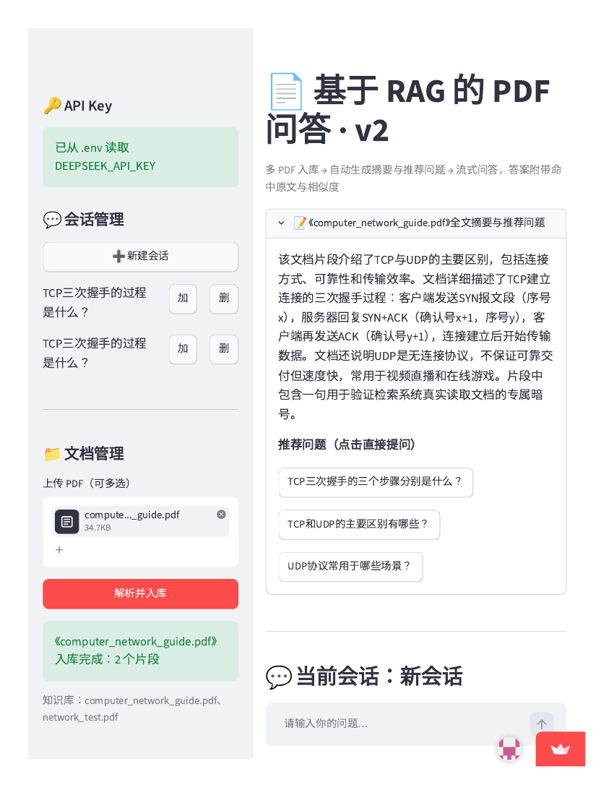
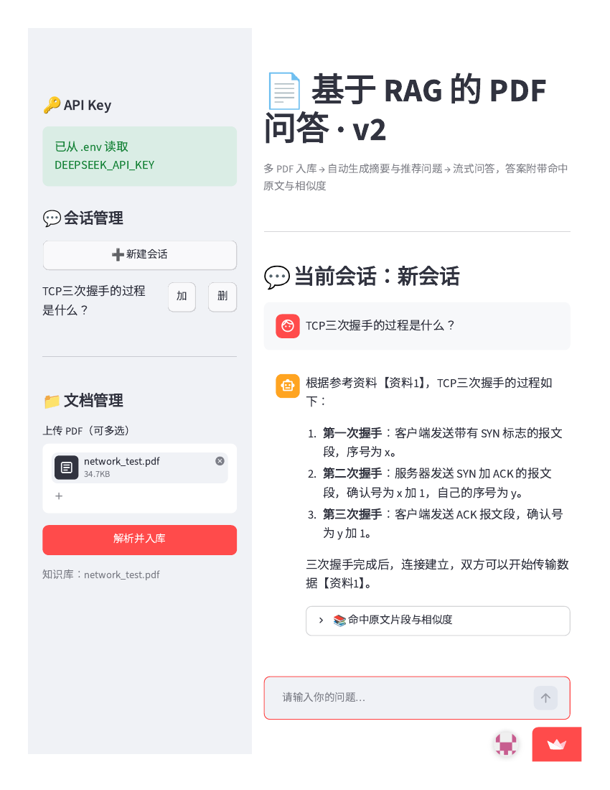
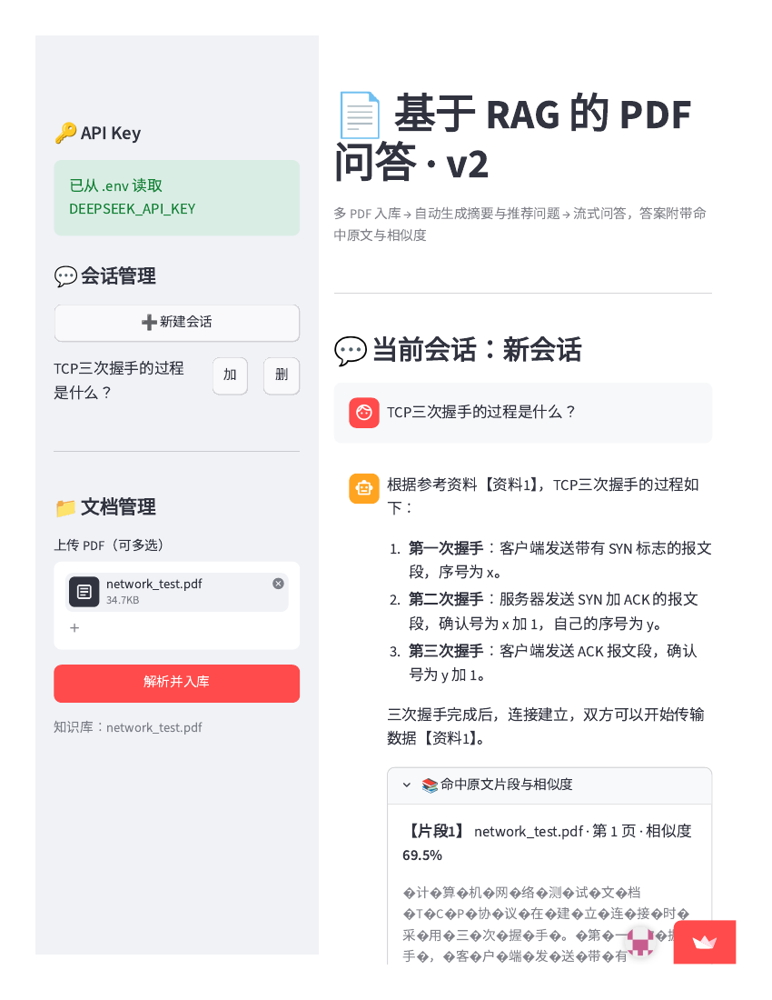
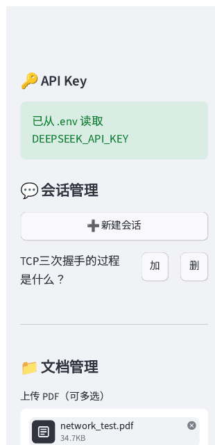
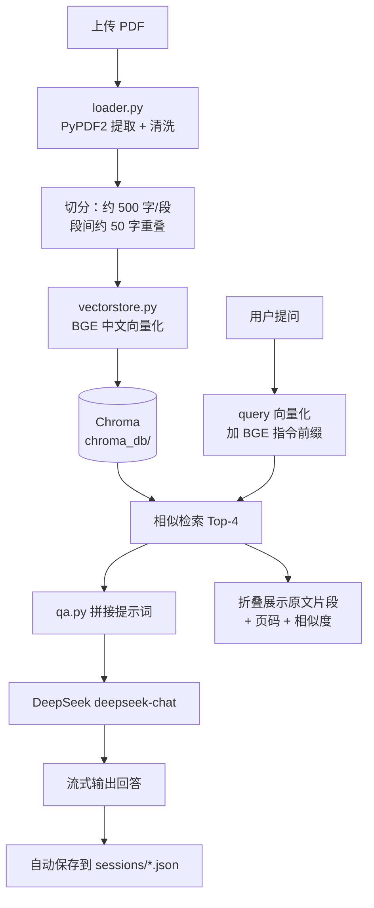

# 📄 基于 RAG 的 PDF 智能问答助手

> 上传 PDF，让大模型只依据你的文档回答问题 —— 答案流式输出，并附带命中原文片段与相似度分数。
> 当前版本：**v2**（Python + Streamlit + Chroma + BGE 中文向量模型 + DeepSeek）

---

## 一、项目介绍

这是一个**检索增强生成（RAG）**的入门级完整实现：把 PDF 切分成文本片段 → 用中文向量模型转成向量存入 Chroma → 提问时先检索最相关的片段 → 把片段拼进提示词交给 DeepSeek 生成回答。

它解决的核心问题是：**大模型不知道你的私有文档内容，而且容易"编造"**。本项目通过"先检索、后生成"的方式，让回答有据可依，并在界面上把依据（原文片段 + 页码 + 相似度）直接展示出来，方便核对。

**设计原则**

| 原则 | 体现 |
| --- | --- |
| 职责单一 | 四个文件各管一件事：解析 / 向量库 / 大模型 / 界面 |
| 轻量无后端 | 不使用数据库、不做登录注册，向量库与会话历史均为本地文件 |
| 中文友好 | 全量中文注释；Key 缺失、网络异常、API 报错均给出中文提示，不崩溃 |
| 密钥安全 | API Key 只从 `.env` 读取，不硬编码进代码，已被 `.gitignore` 忽略 |

---

## 二、功能特性

- **多 PDF 上传**：一次选择多个文件批量入库，已入库文档自动跳过，不重复向量化
- **流式回答**：`stream` 模式逐字输出，打字机效果，无需等待完整响应
- **引用可溯源**：回答下方折叠展示命中的原文片段，标注文件名、页码、相似度百分比
- **自动摘要 + 推荐问题**：文档入库后自动生成全文摘要与 3 个推荐问题，点击即可直接提问
- **会话管理**：新建 / 加载 / 删除历史会话，每轮问答自动保存为本地 JSON
- **中文向量检索**：`BAAI/bge-small-zh-v1.5`，检索 query 自动加 BGE 官方指令前缀
- **重启不丢数据**：向量库持久化到 `chroma_db/`，已入库文档无需重新处理
- **可选访问密码**：配置 `APP_PASSWORD` 后需输密码才能进入，未配置则完全不启用（本地无感）

---

## 三、功能截图

> ⚠️ 截图待补充：启动应用后按下面场景截图，覆盖 `docs/screenshots/` 中同名文件即可（建议宽度 1200px 左右）。

| 场景 | 预览 |
| --- | --- |
| 文档上传与自动摘要 |  |
| 流式问答与引用来源 |  |
| 命中原文与相似度 |  |
| 侧边栏会话管理 |  |

---

## 四、技术架构

### 4.1 技术栈

| 层次 | 选型 | 说明 |
| --- | --- | --- |
| 界面 | Streamlit | 纯 Python 写 Web UI，无需前端代码 |
| PDF 解析 | PyPDF2 | 逐页提取文本并清洗 |
| 向量模型 | sentence-transformers · `BAAI/bge-small-zh-v1.5` | 中文语义向量，约 100MB，输出 512 维 |
| 向量库 | Chroma（`PersistentClient`） | 本地持久化，余弦距离检索 |
| 大模型 | DeepSeek（`deepseek-chat`） | OpenAI 兼容 SDK，支持流式 |
| 配置 | python-dotenv | 从 `.env` 读取 `DEEPSEEK_API_KEY` |

### 4.2 模块职责

| 文件 | 职责 | 关键接口 |
| --- | --- | --- |
| `app.py` | 界面与交互：上传、流式聊天、来源展示、会话管理 | `handle_question()` / `render_sources()` / `save_current_session()` |
| `loader.py` | PDF 文本提取与切分 | `load_and_split_pdf(file)` → `[{text, page}]` |
| `vectorstore.py` | 向量化与相似检索 | `add_document()` / `similarity_search()` / `document_exists()` / `list_documents()` |
| `qa.py` | 调用 DeepSeek 生成回答 | `stream_answer()` / `generate_answer()` / `generate_doc_brief()` / `get_api_key()` |

### 4.3 数据流转



### 4.4 文本切分策略

1. 清洗：统一换行符、合并段内换行、压缩多余空格
2. 按中文句末标点（`。！？；`）切句
3. 逐句累积到约 **500 字**成段；新段落从上一自然段尾取约 **50 字**作为重叠，避免截断语义
4. 单句超过 500 字时，退化为 500/50 的**字符滑动窗口**硬切兜底

---

## 五、本地运行步骤

### 1. 准备环境

```bash
git clone <你的仓库地址>
cd pdf_qa_app
python -m venv .venv

# Windows
.venv\Scripts\activate
# macOS / Linux
source .venv/bin/activate
```

### 2. 安装依赖

```bash
pip install -r requirements.txt
```

> 依赖：`streamlit`、`PyPDF2`、`sentence-transformers`、`chromadb`、`openai`、`python-dotenv`

### 3. 配置 API Key

复制模板并填入自己的 Key（在 [DeepSeek 控制台](https://platform.deepseek.com/) 申请）：

```bash
cp .env.example .env
```

编辑 `.env`：

```ini
DEEPSEEK_API_KEY=sk-你的DeepSeekKey
```

> 也可以直接用系统环境变量（优先级高于 `.env`）；
> Windows PowerShell：`setx DEEPSEEK_API_KEY "你的Key"`，设置后需重开终端。

### 4. 启动应用

```bash
streamlit run app.py
```

浏览器会自动打开 `http://localhost:8501`。

### 5. 开始使用

1. 左侧「文档管理」上传一个或多个 PDF → 点「解析并入库」
2. 首次运行会自动从 `hf-mirror` 下载向量模型（约 100MB），请耐心等待
3. 主区查看自动生成的摘要，或直接点击推荐问题
4. 底部输入框提问，回答流式输出，展开「📚 命中原文片段与相似度」核对依据

---

## 六、Streamlit Cloud 部署步骤

### 1. 推送代码到 GitHub

确保根目录含 `app.py` 与 `requirements.txt`，并确认 `.env` **没有**被提交（已在 `.gitignore` 中）：

```bash
git status          # 确认无 .env
git add . && git commit -m "feat: RAG PDF QA v2" && git push
```

### 2. 创建应用

1. 打开 [share.streamlit.io](https://share.streamlit.io/)，用 GitHub 账号登录
2. 点 **New app** → 选择仓库、分支
3. **Main file path** 填 `app.py`（本仓库根目录即项目根目录）
4. Python version 选 **3.10+**

### 3. 配置密钥与访问密码（关键）

在应用页面 → **Settings → Secrets** 填入（TOML 格式）：

```toml
DEEPSEEK_API_KEY = "sk-你的DeepSeekKey"
APP_PASSWORD = "你想设置的访问密码"   # 不需要密码就删掉这一行
```

保存后应用会自动重启。`load_dotenv(override=False)` 不会覆盖云端注入的环境变量，因此 Secrets 优先生效。

> **访问密码说明**：配置了 `APP_PASSWORD` 后，打开应用会先要求输入密码，验证通过才进入主界面（同一浏览器会话内只需输一次）。本地开发不配置该变量时，密码功能自动关闭，完全无感。详见 `部署指南_GitHub与StreamlitCloud.md`。

### 4. 等待首次构建

- 云端会安装依赖并**下载 BGE 向量模型**（约 100MB），首次冷启动可能需要数分钟
- 若下载 HuggingFace 卡顿，代码已内置 `HF_ENDPOINT=https://hf-mirror.com` 镜像

### 5. 云端注意事项

| 事项 | 说明 |
| --- | --- |
| 知识库不持久 | 云端容器重启后 `chroma_db/` 会被清空，需要重新上传 PDF（免费版无持久磁盘） |
| 会话历史不持久 | `sessions/*.json` 同理，重启后丢失 |
| 资源限制 | 免费版约 1GB 内存；`bge-small-zh-v1.5` + Chroma 可正常运行，但不宜上传超大 PDF |
| 密钥安全 | 永远通过 Secrets 注入，不要把 `.env` 提交到仓库 |

---

## 七、目录结构

```
pdf_qa_app/
├── app.py              # Streamlit 界面（上传 / 聊天 / 来源 / 会话管理）
├── loader.py           # PDF 解析与文本切分
├── vectorstore.py      # 向量化与 Chroma 检索
├── qa.py               # DeepSeek 调用（流式 / 摘要 / 推荐问题）
├── requirements.txt    # 依赖清单
├── .env                # API Key（本地，不提交）
├── .env.example        # 配置模板
├── .gitignore
├── 修改说明_v2.md       # v1 → v2 改动说明
├── chroma_db/          # 向量库（运行时生成，不提交）
├── sessions/           # 会话历史 JSON（运行时生成，不提交）
└── docs/screenshots/   # 功能截图占位
```

---

## 八、运行测试

测试全部使用假数据（mock），**不会调用真实 DeepSeek API、不会下载向量模型**。

```bash
# 安装（若使用项目 venv）
pip install pytest

# 在项目根目录 pdf_qa_app 下运行
pytest tests -v                      # 显示每个用例名
pytest tests -q                      # 只显示汇总
pytest tests/test_loader.py -v       # 只跑切分相关用例
pytest tests/test_qa.py -k JSON      # 只跑名字含 JSON 的用例
```

当前用例：28 个，覆盖 `loader.py` 的文本清洗/切句/重叠切分/硬切兜底，以及 `qa.py` 的 JSON 解析（含代码块围栏、非法 JSON 降级）、错误处理（缺 Key / 401 / 网络失败）与流式输出拼接。

## 九、常见问题

**Q：提示"未检测到 API Key"？**
A：确认 `.env` 与 `app.py` 同级、文件名为 `.env`（不是 `.env.txt`）、内容格式为 `DEEPSEEK_API_KEY=sk-xxx`，改完后重启应用。

**Q：PDF 上传后提示"未提取到文本"？**
A：说明是扫描件（图片型 PDF）。PyPDF2 只能读取文本层，需要接入 OCR（如 PaddleOCR / pytesseract）后再入库。

**Q：回答不准确或说"根据现有资料无法回答"？**
A：检索未命中有效片段。可在 `app.py` 中把 `similarity_search(question, top_k=4)` 的 `top_k` 调大（如 6），或检查文档是否已成功入库。

**Q：想换更强的模型？**
A：修改 `qa.py` 顶部的 `MODEL` 常量即可（如 `deepseek-reasoner`），接口地址无需改动。

**Q：如何清空知识库？**
A：删除 `chroma_db/` 目录后重启应用；删除 `sessions/` 可清空全部历史会话。
