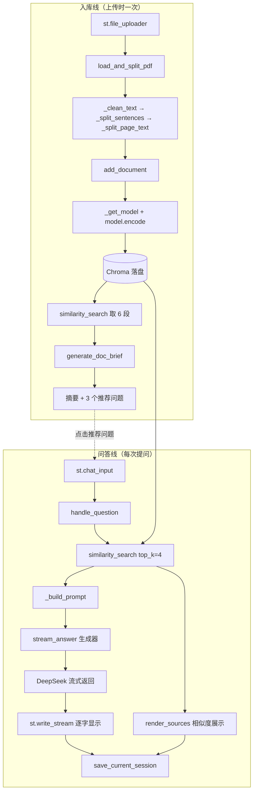

# 《代码讲解文档》—— 逐行读懂这个 RAG 项目

> **读者定位**：会写一点 Python（变量、函数、循环、字典），但没接触过 Streamlit / 向量数据库 / 大模型 API。
> **读完目标**：能逐行看懂四个文件，能给别人讲清楚"一份 PDF 是怎么变成一句回答的"。
> **阅读顺序**：`loader.py`（最独立、最好懂）→ `vectorstore.py` → `qa.py` → `app.py`（最后看，它把前三个串起来）。
> 本文的讲解顺序按你要求的 app / loader / vectorstore / qa 排列，但**第一次阅读建议按上面的顺序看**，会更轻松。

---

## 0. 先看全局：四个文件怎么分工

一句话版本：

> **loader 把 PDF 变文字块 → vectorstore 把文字块变向量并支持检索 → qa 把检索结果拼进提示词交给大模型 → app 把这一切做成网页。**

| 文件 | 一句话职责 | 它不知道的事 |
| --- | --- | --- |
| `loader.py` | 读 PDF、切段 | 不知道向量、不知道大模型 |
| `vectorstore.py` | 向量化、存 Chroma、相似检索 | 不知道 PDF 长什么样、不知道大模型 |
| `qa.py` | 调 DeepSeek 生成回答 | 不知道界面长什么样、不知道向量怎么算 |
| `app.py` | 网页界面与交互流程 | 自己不实现算法，只调用前三个文件 |

这种"每个文件只管一件事"的写法叫**单一职责**，好处是：想换模型只改 `qa.py`，想换切分方式只改 `loader.py`，其余文件一行不用动。

---

## 1. app.py —— 系统的"前台"

### 1.1 它到底负责什么？

`app.py` 是整个程序唯一的**入口**（你运行的 `streamlit run app.py` 就是它），它负责三件事：把三个模块的函数按正确顺序串起来、把结果画成网页、以及记住"用户当前聊到哪了"。它自己**不做任何算法**——不解析 PDF、不算向量、不调 API，全部是"调别人"。

理解它有个关键前提：**Streamlit 的运行模型很特殊**——你写的脚本不是只跑一次，而是**每次用户有任何操作（点按钮、输入文字），整个脚本从上到下重新跑一遍**。所以界面上"记住了什么"必须存在 `st.session_state` 里，普通 Python 变量每次重跑都会丢失。这一点想通了，`app.py` 就懂了一半。

### 1.2 关键代码逐段

#### ① 会话目录与页面设置

```python
PROJECT_ROOT = os.path.dirname(os.path.abspath(__file__))
SESSION_DIR = os.path.join(PROJECT_ROOT, "sessions")
os.makedirs(SESSION_DIR, exist_ok=True)

st.set_page_config(page_title="PDF 智能问答 v2", page_icon="📄", layout="wide")
```

**在干什么**：算出"当前文件所在目录"，在其下面建一个 `sessions` 文件夹，用来放会话历史 JSON；然后设置网页标题。
**为什么这样写**：用 `__file__`（当前文件路径）推导目录，而不是写死 `"./sessions"`，这样无论你在哪个目录下敲命令启动，路径都不会错。`exist_ok=True` 表示"目录已存在就别报错"，避免第二次启动时崩掉。

#### ② 会话读写：四个小函数

```python
def list_sessions() -> list[dict]:
    items = []
    for name in os.listdir(SESSION_DIR):
        if not name.endswith(".json"):
            continue
        try:
            with open(os.path.join(SESSION_DIR, name), "r", encoding="utf-8") as f:
                items.append(json.load(f))
        except Exception:
            continue          # 跳过损坏的文件，不影响整体加载
    items.sort(key=lambda x: x.get("updated_at", ""), reverse=True)
    return items
```

**在干什么**：遍历 `sessions/` 下所有 `.json`，读成字典放进列表，按 `updated_at` 倒序（最近聊的排最前）。
**为什么这样写**：会话是"一个文件一个会话"，所以列出文件就等于列出会话，不需要数据库。`try/except` 包住读取，是为了**任何一个文件损坏都不会导致整个界面白屏**——这种"局部失败不影响全局"的写法值得记住。

```python
def save_current_session():
    data = {
        "id": st.session_state.session_id,
        "title": st.session_state.session_title,
        "created_at": st.session_state.session_created,
        "updated_at": _now_str(),
        "messages": st.session_state.messages,
    }
    with open(_session_path(data["id"]), "w", encoding="utf-8") as f:
        json.dump(data, f, ensure_ascii=False, indent=2)
```

**在干什么**：把当前会话打包成字典写进 JSON 文件。
**为什么这样写**：`ensure_ascii=False` 是关键——不然中文会被写成 `\u4f60\u597d` 这种转义，文件打开看不懂；`indent=2` 让文件有缩进，方便人肉检查。

```python
def new_session():
    st.session_state.session_id = f"{int(time.time())}_{os.urandom(3).hex()}"
    st.session_state.session_title = "新会话"
    st.session_state.session_created = _now_str()
    st.session_state.messages = []
```

**在干什么**：生成一个新的会话 ID 并清空消息列表。
**为什么这样写**：ID 用**时间戳 + 随机hex**，保证同一秒连点两次也不会重名（`os.urandom(3).hex()` 产生 3 字节随机数转十六进制，如 `a1b2c3`）。注意这里清空的是 `session_state` 里的值，所以重跑脚本后依然是"空会话"。

#### ③ session_state 初始化

```python
if "session_id" not in st.session_state:
    new_session()
if "doc_briefs" not in st.session_state:
    st.session_state.doc_briefs = {}
if "pending_question" not in st.session_state:
    st.session_state.pending_question = None
```

**在干什么**：第一次运行时给状态机"播种"。
**为什么这样写**：因为脚本**每次操作都重跑**，如果不加 `if not in` 判断，`new_session()` 会把你刚聊的内容全部清空。这四行是 Streamlit 项目里最常见的写法，几乎每个 Streamlit 应用开头都有类似代码。

#### ④ 展示命中片段与相似度

```python
def render_sources(sources: list[dict]):
    with st.expander("📚 命中原文片段与相似度"):
        for i, s in enumerate(sources, start=1):
            sim = max(0.0, 1.0 - float(s["score"])) * 100
            st.markdown(f"**【片段{i}】** {s['source']} · 第 {s['page']} 页 · 相似度 **{sim:.1f}%**")
            st.caption(s["text"])
            st.progress(min(max(sim / 100.0, 0.0), 1.0))
```

**在干什么**：把检索到的片段画成可折叠区域，每条显示来源、页码、相似度百分比和一条进度条。
**为什么这样写**：Chroma 返回的是**余弦距离**（0 = 完全相同，越大越不相关），用户看"距离 0.13"没有直觉，所以换算成 `相似度 = 1 - 距离` 的百分比。`max(0.0, ...)` 防止浮点误差算出负数；进度条要求 0~1 之间的小数，所以再 `min(max(...))` 夹一次。这个"把机器友好的数字翻译成人能懂的数字"的思路，就是界面层的价值。

#### ⑤ 核心：处理一次提问

```python
def handle_question(question: str):
    if not st.session_state.messages:
        st.session_state.session_title = question[:20]   # 用第一个问题当会话标题

    st.session_state.messages.append({"role": "user", "content": question})
    with st.chat_message("user"):
        st.markdown(question)

    contexts, answer = [], None
    with st.chat_message("assistant"):
        try:
            contexts = similarity_search(question, top_k=4)
            answer = st.write_stream(stream_answer(question, contexts))
        except QAFriendlyError as e:
            st.warning(str(e))
        except Exception as e:
            st.error(f"出现未预期的错误：{e}")

        if answer is not None:
            render_sources(contexts)
            st.session_state.messages.append(
                {"role": "assistant", "content": answer, "sources": contexts})
        else:
            st.session_state.messages.append(
                {"role": "assistant", "content": "⚠️ 本次未生成回答，请检查 API Key 或网络后重试。"})
    save_current_session()
```

**在干什么**：这是**一次问答的完整流程**，也是整个项目的心脏：记问题 → 检索 → 流式生成 → 展示来源 → 存历史 → 自动保存会话。
**为什么这样写**（四个要点）：
1. `contexts, answer = [], None` 先给默认值：因为如果 `similarity_search` 就抛异常了，后面 `render_sources(contexts)` 会用到 `contexts`，不预置就会 `NameError`。这是很实用的防御习惯。
2. `st.write_stream(...)` 接收一个**生成器**，会自动一段一段消费并渲染，这就是"打字机效果"的来源；它返回拼接好的完整字符串，正好用来存历史。
3. 两个 `except` 分开写：`QAFriendlyError` 是我们自己定义的"已知错误"（Key 没配、API 挂了），用黄条提示；其他未知异常用红条。**绝不直接崩溃**。
4. `save_current_session()` 放在最外面，无论成功失败都会落盘，保证历史不丢。

#### ⑥ 侧边栏：多文件上传 + 自动生成摘要

```python
uploaded_files = st.file_uploader("上传 PDF（可多选）", type=["pdf"], accept_multiple_files=True)
if uploaded_files and st.button("解析并入库", type="primary", use_container_width=True):
    for f in uploaded_files:
        if document_exists(f.name):
            st.info(f"《{f.name}》已入库，跳过。")
            continue
        chunks = load_and_split_pdf(f)
        n = add_document(f.name, chunks)
        ctx = similarity_search("本文的主要内容、核心观点、结论与关键信息是什么",
                                top_k=6, source=f.name)
        st.session_state.doc_briefs[f.name] = generate_doc_brief(f.name, ctx)
```

**在干什么**：一次选多个 PDF → 逐个入库 → 每个入库后立刻检索 6 段 → 生成摘要和推荐问题存入 `doc_briefs`。
**为什么这样写**：`accept_multiple_files=True` 让返回值变成**列表**，所以要用 `for` 循环。这里有个巧妙的细节：**摘要不是把整篇 PDF 塞给大模型**（太长、太贵），而是用一句通用问题去检索 6 个最能代表全文的片段，再让模型总结这 6 段——这是 RAG 项目里常见的省钱技巧。另外 `source=f.name` 限定只在这一个文档内检索，避免多篇文档混在一起。

#### ⑦ 推荐问题"点击即提问"的实现

```python
for i, q in enumerate(questions):
    if st.button(q, key=f"sug_{name}_{i}"):
        st.session_state.pending_question = q
# ...脚本末尾...
if st.session_state.pending_question:
    q = st.session_state.pending_question
    st.session_state.pending_question = None
    handle_question(q)
```

**在干什么**：推荐问题渲染成按钮；点下去后并不是立刻回答，而是先把问题存进 `pending_question`，等脚本跑到最后再统一处理。
**为什么这样写**：Streamlit 的按钮**不能"返回值给上面"**——它只是在本次重跑中返回 `True`。如果按钮上方已经渲染过聊天区，直接在按钮里回答会导致回答出现在错误的位置。所以用"存一个待办 → 脚本末尾消费"的套路。`key=f"sug_{name}_{i}"` 必须给，因为同一页面有多个按钮，Streamlit 靠 `key` 区分身份，不写会报错。

### 1.3 涉及的知识点

| 知识点 | 说明 |
| --- | --- |
| **Streamlit 重跑模型** | 每次交互脚本整体重跑一次，普通变量会丢，状态必须放 `st.session_state` |
| `st.session_state` | 一个跨重跑存活的字典，`st.session_state.xxx` 等价于字典取值 |
| `st.write_stream` | 接收**生成器**并流式渲染，返回完整字符串 |
| `st.chat_message` / `st.chat_input` | 聊天气泡与底部输入框 |
| `st.expander` / `st.columns` / `st.progress` | 折叠面板、横向分栏、进度条 |
| `st.rerun()` | 让脚本立刻再跑一次（切换会话后用它刷新界面） |
| **按钮 key 唯一性** | 循环里生成按钮必须给唯一 `key` |
| `with` 上下文管理器 | `with open(...)`、`with st.expander(...)` 都用它自动管理资源/区域 |
| JSON 序列化 | `json.dump/load`，`ensure_ascii=False` 保证中文可读 |
| 防御式默认值 | 先给 `contexts, answer` 默认值，避免异常路径下变量未定义 |

### 1.4 自测问题（不给答案，试着自己讲出来）

1. 如果删掉 `if "session_id" not in st.session_state:` 这个判断，每次点按钮会发生什么？为什么？
2. `st.write_stream(stream_answer(...))` 这一行里，`stream_answer` 是函数还是生成器？如果把它写成 `stream_answer(question, contexts)()` 会怎样？
3. 为什么推荐问题按钮不直接调用 `handle_question(q)`，而是先存进 `pending_question`？如果直接调用会出现什么界面问题？

---

## 2. loader.py —— 把 PDF 变成"可检索的文字块"

### 2.1 它到底负责什么？

它是整条流水线的第一道工序：拿一个 PDF（文件或类文件对象），吐出一串 `{text, page}` 字典。它**不知道向量、不知道大模型**，只干两件事——**把文字抠出来**和**切成合适大小的段**。切分之所以重要，是因为大模型有输入长度限制，而且"把整本书塞进去"既贵又容易被无关内容干扰；检索只需要找出最相关的几段。

### 2.2 关键代码逐段

#### ① 两个常量：切分的"尺码"

```python
CHUNK_SIZE = 500      # 每段目标长度（字符）
CHUNK_OVERLAP = 50    # 段与段之间重叠的字符数
```

**为什么这样写**：把魔法数字提成**模块级常量**，改需求时只改一处。500 是中文场景下比较平衡的长度——够容纳完整语义，又不至于塞进太多无关内容。

#### ② 清洗文本：PDF 提取出来的是"脏"的

```python
def _clean_text(text: str) -> str:
    text = text.replace("\r\n", "\n").replace("\r", "\n")   # 统一换行符
    text = re.sub(r"\n{2,}", "\n", text)                    # 多个空行压成一个
    text = text.replace("\n", "")                           # 段内换行直接去掉
    text = re.sub(r"[ \t]+", " ", text)                     # 连续空格压成一个
    return text.strip()
```

**在干什么**：把 PDF 抽出的乱七八糟换行/空格整理成干净的一段文字。
**为什么这样写**：PDF 里的换行是**排版换行**，不是语义换行——一句话常常被硬生生断成三行。如果不合并，后面的"按句号切句"会被换行卡住，切出来的句子全是半句。中文尤其如此（中文不是靠空格分词的）。注意去换行后中英文之间可能会粘连，本项目接受这个代价，优先保证句子完整。

#### ③ 切句：用正则的"后顾断言"

```python
def _split_sentences(text: str) -> list[str]:
    sentences = re.split(r"(?<=[。！？；!?;])", text)
    return [s for s in sentences if s.strip()]
```

**在干什么**：在中文句末标点后面下刀，把一段话切成一句一句。
**为什么这样写**：`(?<=...)` 是**后顾断言**（lookbehind），意思是"匹配一个位置，这个位置前面必须是这些标点之一"。用它而不是直接 `split("。")`，是因为 `split` 会把句号本身吃掉，而断言只定位、不消耗字符，**句号得以保留在句尾**——读起来才完整。最后一行用列表推导过滤掉空白片段。

#### ④ 兜底硬切：滑动窗口

```python
def _hard_split(sentence: str) -> list[str]:
    chunks = []
    step = CHUNK_SIZE - CHUNK_OVERLAP      # 450
    for start in range(0, len(sentence), step):
        chunk = sentence[start:start + CHUNK_SIZE]
        if chunk.strip():
            chunks.append(chunk)
        if start + CHUNK_SIZE >= len(sentence):
            break
    return chunks
```

**在干什么**：对付"一整页没有句号"的极端长句（比如表格数据、代码、长标题），按固定 500 字、步长 450 硬切。
**为什么这样写**：`range(0, len, 450)` 的步长不是 500 而是 **500-50=450**，这样相邻两段天然有 50 字重叠。`if start + CHUNK_SIZE >= len(sentence): break` 防止最后切出一个极短的尾巴段。

#### ⑤ 主切分逻辑：累积 + 重叠

```python
def _split_page_text(text: str) -> list[str]:
    sentences = _split_sentences(text)
    chunks, current = [], ""

    for sentence in sentences:
        if len(sentence) > CHUNK_SIZE:            # 单句超长：先结算，再硬切
            if current:
                chunks.append(current)
                current = ""
            chunks.extend(_hard_split(sentence))
            continue

        if len(current) + len(sentence) <= CHUNK_SIZE:
            current += sentence                    # 还没满，继续攒
        else:
            chunks.append(current)                 # 满了，输出这一段
            overlap = ""
            for s in reversed(_split_sentences(current)):
                if len(overlap) + len(s) > CHUNK_OVERLAP:
                    break
                overlap = s + overlap               # 从尾部倒着凑约 50 字
            current = overlap + sentence            # 新段 = 重叠部分 + 当前句

    if current.strip():
        chunks.append(current)
    return chunks
```

**在干什么**：逐句往 `current` 里塞，塞到接近 500 字就输出一段，并从这段的**尾部**取几个句子（凑够约 50 字）作为下一段的开头。
**为什么这样写**（三个要点）：
1. **重叠的意义**：如果一个完整的观点正好横跨第 500 字，切断后两段各自都"半残"。保留 50 字重叠，保证任何一句话至少在某一整段里完整出现，检索时不会漏。
2. **重叠按句子取，不按字符取**：`for s in reversed(...)` 从最后一句往前凑，直到再加一句就超过 50 字为止。这样重叠部分不会把一个句子切成半截，比"直接切最后 50 个字符"质量高。
3. `continue` 之后 `current` 已被清空，保证超长句硬切出来的片段不会被前面的内容污染。

#### ⑥ 对外主入口

```python
def load_and_split_pdf(file) -> list[dict]:
    reader = PdfReader(file)
    results = []
    for page_no, page in enumerate(reader.pages, start=1):
        raw = page.extract_text() or ""
        cleaned = _clean_text(raw)
        if not cleaned:
            continue                      # 跳过无文本的页（纯图片/扫描页）
        for chunk in _split_page_text(cleaned):
            results.append({"text": chunk, "page": page_no})
    return results
```

**在干什么**：逐页提取 → 清洗 → 切分 → 给每个片段打上页码。
**为什么这样写**：**按页切分而不是整篇切分**，是为了让每个片段能带上准确的页码——这样界面上才能告诉你"这句话出自第 3 页"。`extract_text() or ""` 防止某页返回 `None` 导致 `.strip()` 报错。`enumerate(..., start=1)` 让页码从 1 开始，符合人类习惯。

### 2.3 涉及的知识点

| 知识点 | 说明 |
| --- | --- |
| **模块级常量** | 大写命名的全局常量，改一处即全局生效 |
| 正则表达式 | `re.sub`、`re.split`；`\n{2,}` 表示两个以上换行；`[ \t]+` 表示一个或多个空格/制表符 |
| **后顾断言 `(?<=...)`** | 只匹配位置不消耗字符，用来保留标点 |
| 列表推导 | `[s for s in sentences if s.strip()]` 一行完成过滤 |
| **滑动窗口** | `range(0, len, step)` 配合切片，步长 < 窗口大小即产生重叠 |
| `enumerate(start=1)` | 同时拿到下标和元素，并指定起始编号 |
| 下划线前缀 `_func` | Python 约定：表示"内部函数"，外部不要直接调用 |
| `or ""` 兜底 | 防止 `None` 传入字符串方法报错 |

### 2.4 自测问题

1. 如果把 `CHUNK_OVERLAP` 改成 0，检索效果会变差还是变好？请举出一个具体会出错的场景。
2. `_split_sentences` 里如果用 `text.split("。")` 代替正则断言，切出来的句子会有什么缺陷？
3. 为什么切分要"按页"进行，而不是把整篇 PDF 拼接后再切？这带来了什么好处、又牺牲了什么？

---

## 3. vectorstore.py —— 把文字变成"可以比远近的数字"

### 3.1 它到底负责什么？

它做的是 RAG 里最核心的一步：**把文字变成向量，并能根据一句话找出最相近的文字块**。具体说：加载 BGE 中文模型把文本编码成 512 维向量、存进本地 Chroma 数据库、提问时把问题也编码成向量并找出 Top-K 个最近的片段。它是四个文件里唯一"懂数学"的。

### 3.2 关键代码逐段

#### ① 必须在 import 之前设置的镜像地址

```python
import os
os.environ.setdefault("HF_ENDPOINT", "https://hf-mirror.com")

import chromadb
from sentence_transformers import SentenceTransformer
```

**在干什么**：把 HuggingFace 的下载源换成国内镜像，然后才导入模型库。
**为什么这样写**：两句的顺序**不能颠倒**。`sentence_transformers` 在导入/首次加载模型时会读取这个环境变量去下载权重（约 100MB），设晚了就没用了。`setdefault` 表示"已存在就不覆盖"，这样你自己设过镜像时不会被强行改掉。这是国内跑 HF 模型的标准操作。

#### ② 模块级缓存：模型只加载一次

```python
_model = None
_collection = None

def _get_model() -> SentenceTransformer:
    global _model
    if _model is None:
        try:
            _model = SentenceTransformer(MODEL_NAME)
        except Exception as e:
            raise RuntimeError(f"向量模型 {MODEL_NAME} 加载失败，请检查网络后重试。原始错误：{e}") from e
    return _model
```

**在干什么**：第一次调用时才真正加载模型，之后直接复用。
**为什么这样写**（三个要点）：
1. **懒加载**：模型加载要几秒甚至几十秒。如果写在模块顶层，光是 `import vectorstore` 就会卡住，连 `app.py` 启动都被拖慢。
2. **`global` 关键字**：在函数里给模块级变量赋值必须声明 `global`，否则 Python 会把它当成新局部变量。
3. **`raise ... from e`**：保留原始异常的因果链，报错时能看到"真正的原因"而不是只剩一句包装话。

#### ③ 建集合：指定余弦空间

```python
client = chromadb.PersistentClient(path=DB_DIR)
_collection = client.get_or_create_collection(
    name=COLLECTION_NAME, metadata={"hnsw:space": "cosine"})
```

**在干什么**：创建一个**持久化**到本地目录的 Chroma 客户端，并取（或建）一个集合，指定用**余弦距离**衡量远近。
**为什么这样写**：`PersistentClient` 会把数据写到磁盘（`chroma_db/`），重启程序还在；换成 `EphemeralClient` 则重启即空。指定 `cosine` 是因为语义检索通常用**余弦相似度**：它只看两个向量的"方向"是否一致，而不受文本长度（向量长度）影响——一篇长文和一个短句，只要说的是同一件事，方向就应该接近。

#### ④ 写入：三件套

```python
embeddings = model.encode(texts, normalize_embeddings=True).tolist()
ids = [f"{filename}::p{c['page']}::{i}" for i, c in enumerate(chunks)]
metadatas = [{"source": filename, "page": c["page"]} for c in chunks]
_collection.add(ids=ids, embeddings=embeddings, documents=texts, metadatas=metadatas)
```

**在干什么**：把 N 个片段一次性编码成向量并写入库。
**为什么这样写**：
- `normalize_embeddings=True` 把向量归一化成"单位长度"，这样余弦相似度就等价于向量点积，计算更快也更稳。
- `documents=texts`：**原文必须一起存**，因为检索只返回你存进去的东西；向量是不可逆的，没法从向量还原文字。
- `metadatas` 存来源和页码，检索时一并带出来，界面才能显示"出自哪个文件第几页"。
- `ids` 用 `文件名::页码::序号` 保证唯一，否则同名片段会互相覆盖。

#### ⑤ 检索：query 要加"指令前缀"

```python
QUERY_INSTRUCTION = "为这个句子生成表示以用于检索相关文章："

query_vec = model.encode(QUERY_INSTRUCTION + query, normalize_embeddings=True).tolist()
kwargs = {"query_embeddings": [query_vec], "n_results": top_k}
if source:
    kwargs["where"] = {"source": source}
result = _get_collection().query(**kwargs)
```

**在干什么**：把问题编码成向量（前面拼一句固定指令），在库里找 Top-K 个最近片段；`source` 有值时只在该文档内检索。
**为什么这样写**（重点）：
1. **指令前缀是 BGE 模型的"使用约定"**：该模型训练时，"用于检索的查询句"都带这句前缀，"被检索的文档"不带。两边格式必须和训练时一致，检索效果才达标。**文档侧不加前缀**（见 `add_document`）——这个不对称是刻意而为，不是笔误。
2. 注意 `query_embeddings=[query_vec]` 是**列表包一层**，因为 Chroma 支持一次查多个向量。
3. `**kwargs` 是**字典解包**传参：这里用它优雅地实现"可选参数"——有 `source` 就多传一个 `where`，没有就不传。
4. `where={"source": ...}` 是**元数据过滤**，先缩小范围再做向量比对，速度更快、结果更纯。

#### ⑥ 返回值里那个 `score` 到底是什么

```python
for doc, meta, dist in zip(result["documents"][0], result["metadatas"][0], result["distances"][0]):
    hits.append({"text": doc, "source": meta["source"], "page": meta["page"], "score": dist})
```

**在干什么**：把 Chroma 返回的三个平行列表"拉链式"合并成字典列表。
**为什么这样写**：Chroma 的返回结构是"每个查询一组结果"，所以 `documents[0]` 表示第一个（也是唯一一个）查询的结果列表。用 `zip` 同时遍历三个列表，比用下标 `for i in range(len(...))` 更 Pythonic、更不容易越界。**记住：`score` 是距离，越小越像**（`app.py` 里把它换算成了百分比）。

### 3.3 涉及的知识点

| 知识点 | 说明 |
| --- | --- |
| **向量嵌入（Embedding）** | 把文本映射成固定长度的数字数组，语义相近 → 向量相近 |
| **余弦相似度 / 余弦距离** | 用向量夹角衡量相似度，忽略长度差异；距离 = 1 − 相似度 |
| 归一化 | `normalize_embeddings=True`，把向量缩到单位长度 |
| **HNSW 索引** | Chroma 底层用的近似最近邻算法，让百万级检索也很快 |
| **持久化 vs 内存** | `PersistentClient` 落盘 / `EphemeralClient` 内存 |
| 懒加载 + `global` | 模块级缓存的经典写法 |
| `**kwargs` 字典解包 | 动态拼接函数参数 |
| `zip` 并行遍历 | 合并多个平行列表 |
| 元数据过滤 `where` | 先过滤再检索，常用于多文档隔离 |
| `raise ... from e` | 保留异常因果链 |

### 3.4 自测问题

1. 如果把 `os.environ.setdefault("HF_ENDPOINT", ...)` 挪到 `import sentence_transformers` 之后，会发生什么？为什么？
2. `add_document` 里为什么文档侧不加 `QUERY_INSTRUCTION` 前缀？如果两边都加会怎样？
3. 检索结果里 `score` 等于 0.02 和 0.85，哪一条更相关？为什么？如果界面要显示百分比，该怎么换算？

---

## 4. qa.py —— 负责"把话说出来"的那张嘴

### 4.1 它到底负责什么？

它是唯一和外部服务（DeepSeek）打交道的文件：把检索到的片段和用户问题拼成提示词，调 API 拿回答，并把各种失败翻译成中文提示。它提供三种能力：**流式回答**（聊天用）、**非流式回答**（备用）、**文档摘要 + 推荐问题**（上传后自动生成）。它不知道界面长什么样，也不知道向量怎么算。

### 4.2 关键代码逐段

#### ① 读取 .env：密钥不进代码

```python
PROJECT_ROOT = os.path.dirname(os.path.abspath(__file__))
ENV_PATH = os.path.join(PROJECT_ROOT, ".env")
load_dotenv(ENV_PATH, override=False)
```

**在干什么**：找到项目根目录下的 `.env`，把里面的键值对加载进环境变量。
**为什么这样写**：
- 用 `__file__` 推导路径，保证任何启动方式都能找对 `.env`。
- `override=False` 表示**不覆盖已存在的系统环境变量**。这带来一个很实用的优先级：**系统环境变量 > .env 文件**。所以临时想换 Key，在终端里 `export`/`setx` 一下即可，不用改文件；部署到 Streamlit Cloud 时，云端注入的 Secrets 也天然优先于可能被误提交的 `.env`。
- 密钥**绝不硬编码**进 `.py`，否则 `git push` 的那一刻它就泄露了。

#### ② 自定义异常：把"技术错误"翻译成"人话"

```python
class QAFriendlyError(Exception):
    """面向用户的中文友好错误，界面直接 str(e) 展示即可。"""
```

**在干什么**：定义一个只继承 `Exception` 的空类，作为"已知业务错误"的标记。
**为什么这样写**：异常类型本身就是**分类标签**。`app.py` 里 `except QAFriendlyError` 用黄条提示（Key 没配、网络挂了，用户能自己解决），其余 `except Exception` 用红条（真 bug）。如果不用自定义异常，就只能去匹配异常的字符串内容，非常脆弱。**自定义异常是分层架构里最便宜、最有效的工具。**

#### ③ Key 校验集中在一处

```python
def get_api_key() -> str:
    return os.environ.get("DEEPSEEK_API_KEY", "").strip()

def _require_client() -> OpenAI:
    api_key = get_api_key()
    if not api_key:
        raise QAFriendlyError(
            "未检测到 API Key。请在项目根目录的 .env 文件中配置 DEEPSEEK_API_KEY=你的Key…")
    return OpenAI(api_key=api_key, base_url=BASE_URL, timeout=60)
```

**在干什么**：读 Key；没有就抛中文错误，有则创建客户端。
**为什么这样写**：`.strip()` 去掉复制粘贴带来的空格（这是最常见的"Key 明明填了却报错"的原因）。把校验收敛到 `_require_client()` 一个函数里，三个生成函数都调它，**校验逻辑只写一遍**。

#### ④ 提示词：RAG 的"灵魂三句话"

```python
return (
    "你是一个严谨的 PDF 问答助手。请只根据下面的参考资料回答用户问题，"
    "并在回答中标注引用的资料编号（如【资料1】）。"
    "如果参考资料无法回答问题，请明确说明“根据现有资料无法回答”，不要编造内容。\n\n"
    f"参考资料：\n{refs}\n\n用户问题：{question}\n\n回答：")
```

**在干什么**：把角色设定、约束、参考资料、问题拼成一段指令。
**为什么这样写**（RAG 提示词的三个必备要素）：
1. **限定依据**："只根据参考资料回答" —— 把模型的回答范围锁死在你的文档里。
2. **要求标注**：让它在句中标【资料1】，用户才能对照下方片段核对。
3. **允许说不知道**：明确告诉它"没找到就说没找到"。**这一条最重要**——不给退路的模型会硬编一个看起来很像真的答案，即幻觉。写提示词时永远要给模型留"我不知道"的出口。

#### ⑤ 流式输出：生成器 `yield`

```python
def stream_answer(question: str, contexts: list[dict]) -> Iterator[str]:
    client = _require_client()
    if not contexts:
        raise QAFriendlyError("没有检索到相关内容，请先上传并成功解析 PDF 文件。")
    try:
        stream = client.chat.completions.create(
            model=MODEL, messages=[...], temperature=0.3, stream=True)
        for chunk in stream:
            if not chunk.choices:      # 结束时的 usage 块 choices 为空
                continue
            delta = chunk.choices[0].delta.content
            if delta:
                yield delta
    except Exception as e:
        raise _friendly(e)
```

**在干什么**：开启 `stream=True`，把模型吐回来的每一个小片段 `yield` 出去。
**为什么这样写**（重点理解生成器）：
1. 函数里有 `yield`，调用它**不会立即执行**，而是返回一个**生成器对象**。真正的执行发生在被迭代时（`for` 或 `st.write_stream`）。所以 `answer = st.write_stream(stream_answer(...))` 才会边收边显示。
2. 非流式是等全部生成完一次性返回（要等好几秒白屏）；流式是**来一个字显示一个字**，体验差距巨大。
3. `if not chunk.choices: continue` 是**必要的保护**：流末尾的统计块（usage）里 `choices` 是空列表，直接取 `[0]` 会 `IndexError`。
4. `delta.content` 可能为 `None`（比如角色消息块），所以要 `if delta:` 过滤。
5. 注意：**生成器里的异常在迭代时才抛出**，所以 `app.py` 的 `try` 必须包住 `st.write_stream(...)` 这一整行，而不是包住 `stream_answer(...)` 的调用——这是初学者的高频踩坑点。

#### ⑥ 错误翻译：一个函数搞定

```python
def _friendly(e: Exception) -> QAFriendlyError:
    if isinstance(e, AuthenticationError):
        return QAFriendlyError("DeepSeek API Key 无效或已过期，请检查 .env 中的 DEEPSEEK_API_KEY。")
    if isinstance(e, APITimeoutError):
        return QAFriendlyError("调用 DeepSeek API 超时，请检查网络后重试。")
    ...
    return QAFriendlyError(f"调用 DeepSeek API 失败：{e}")
```

**在干什么**：把 SDK 的各种异常类型映射成中文提示。
**为什么这样写**：用户看到 `APITimeoutError: Request timed out.` 不知道该怎么办；看到"调用超时，请检查网络后重试"就知道下一步。所有网络调用都应该做这层翻译。

#### ⑦ 摘要与推荐问题：让模型输出 JSON

```python
prompt = (...'{"summary": "200 字以内的中文全文摘要", "questions": ["问题1", "问题2", "问题3"]}'...)
raw = resp.choices[0].message.content.strip()
raw = re.sub(r"^```(?:json)?|```$", "", raw).strip()   # 去掉可能的代码块围栏
try:
    data = json.loads(raw)
    questions = [str(q).strip() for q in data.get("questions", [])][:3]
    return {"summary": str(data.get("summary", "")).strip(), "questions": questions}
except Exception:
    return {"summary": raw, "questions": []}   # 解析失败降级，不中断流程
```

**在干什么**：要求模型返回严格 JSON，解析出摘要和 3 个问题；解析失败就把原文当摘要。
**为什么这样写**：
- 让模型输出结构化数据（而不是自由文本），界面才能把 3 个问题分别渲染成 3 个按钮——**结构化输出是"让程序消费模型结果"的前提**。
- `re.sub` 去掉 ```` ```json ```` 围栏：模型经常"好心"地给 JSON 包一层代码块，直接 `json.loads` 会失败，这一步是必要的容错。
- `[:3]` 强制最多取 3 条，防止模型给你 5 条。
- 最后的 `except` **降级而非崩溃**：模型偶尔会返回不合法 JSON（比如里面带了换行），此时把原文当摘要展示，用户照样能看到内容，流程不中断。这种"最后一道兜底"思维在整个项目里反复出现。

### 4.3 涉及的知识点

| 知识点 | 说明 |
| --- | --- |
| **环境变量与 .env** | 配置与代码分离；`load_dotenv(override=False)` 的优先级语义 |
| **自定义异常** | 用异常类型做错误分类，实现分层处理 |
| **生成器 `yield`** | 惰性执行、流式输出；异常在迭代时才抛出 |
| **流式 API 协议** | `stream=True` + 遍历 chunk + `delta.content` |
| **提示词工程** | 限定依据 / 要求标注 / 允许说不知道 |
| `temperature` | 越低越确定（0.3），问答场景不需要 creativity |
| OpenAI 兼容调用 | 换 `base_url` 即可切换 DeepSeek |
| **结构化输出** | 让模型返回 JSON 供程序消费 |
| `json.loads` / `re.sub` | 解析与容错 |
| 降级设计 | 解析失败给可用结果，而不是抛异常 |

### 4.4 自测问题

1. 为什么 `stream_answer` 是生成器函数？如果在 `app.py` 里写 `try: gen = stream_answer(...)` / `except: ...`，能把 API 调用中的错误捕获住吗？为什么？
2. `load_dotenv(ENV_PATH, override=False)` 中 `override=False` 意味着什么？如果用户在终端里已经设置了另一个 `DEEPSEEK_API_KEY`，实际生效的是哪一个？
3. 提示词里"如果无法回答就明确说明"这句话有什么作用？删掉它最可能出现什么问题？

---

## 5. 完整数据流：从上传 PDF 到看到回答

下面把两条线分别画出来。**入库线**只在上传时跑一次，**问答线**每次提问都跑一遍。

### 5.1 入库线（上传 PDF → 摘要 + 推荐问题）

| 步骤 | 发生在 | 调用的函数 | 输入 → 输出 |
| --- | --- | --- | --- |
| 1 | app.py | `st.file_uploader(...)` | 用户选文件 → UploadedFile 列表 |
| 2 | app.py | `document_exists(f.name)` | 文件名 → 是否已入库（去重） |
| 3 | loader.py | `load_and_split_pdf(f)` | PDF → `[{text, page}, ...]` |
| 3.1 | loader.py | `page.extract_text()` | 单页 → 原始文本 |
| 3.2 | loader.py | `_clean_text()` | 原始文本 → 干净文本 |
| 3.3 | loader.py | `_split_sentences()` | 干净文本 → 句子列表 |
| 3.4 | loader.py | `_split_page_text()` | 句子列表 → 约 500 字段落（含 50 字重叠） |
| 3.5 | loader.py | `_hard_split()`（仅超长句） | 超长句 → 硬切片段 |
| 4 | vectorstore.py | `add_document(name, chunks)` | 片段 → 写入 Chroma，返回条数 |
| 4.1 | vectorstore.py | `_get_model()` → `model.encode()` | 文本 → 512 维向量 |
| 4.2 | vectorstore.py | `collection.add(...)` | 向量 + 原文 + metadata → 落盘 |
| 5 | vectorstore.py | `similarity_search(通用问题, top_k=6, source=文件名)` | 问题 → 该文档 6 个代表片段 |
| 6 | qa.py | `generate_doc_brief(name, ctx)` | 片段 → `{summary, questions[3]}` |
| 6.1 | qa.py | `_require_client()` → DeepSeek API | 提示词 → JSON 文本 |
| 7 | app.py | 存入 `st.session_state.doc_briefs` | 界面展示摘要与 3 个按钮 |

### 5.2 问答线（输入问题 → 看到流式回答）

| 步骤 | 发生在 | 调用的函数 | 输入 → 输出 |
| --- | --- | --- | --- |
| 1 | app.py | `st.chat_input(...)` / 推荐问题按钮 | 用户 → 问题字符串 |
| 2 | app.py | `handle_question(question)` | 问题 → 走完下面所有步骤 |
| 3 | vectorstore.py | `similarity_search(question, top_k=4)` | 问题 → Top-4 片段（含 score） |
| 3.1 | vectorstore.py | `_get_model()` → `encode(指令前缀 + 问题)` | 问题 → query 向量 |
| 3.2 | vectorstore.py | `collection.query(...)` | query 向量 → 最近邻 + 距离 |
| 4 | qa.py | `stream_answer(question, contexts)` | 问题 + 片段 → **生成器** |
| 4.1 | qa.py | `_build_prompt()` | 片段 + 问题 → 完整提示词 |
| 4.2 | qa.py | DeepSeek `create(stream=True)` | 提示词 → 逐 chunk 流 |
| 5 | app.py | `st.write_stream(生成器)` | 逐 chunk → 页面逐字渲染 |
| 6 | app.py | `render_sources(contexts)` | 片段 + score → 折叠区（相似度 = 1 − 距离） |
| 7 | app.py | `save_current_session()` | 消息列表 → `sessions/<id>.json` |

### 5.3 一图流（函数级）



### 5.4 一句话总结（讲给别人听时用）

> 用户上传 PDF 后，`loader` 把它切成 500 字一段的文字块，`vectorstore` 用 BGE 模型把这些块变成向量存进 Chroma；用户提问时，`vectorstore` 先把问题也变成向量、找出最像的 4 段，`qa` 把这 4 段和问题拼成提示词交给 DeepSeek 并以流的方式吐字，`app` 一边把字显示在屏幕上、一边把原文片段和相似度折叠在下方供核对，最后把整轮对话存成本地 JSON。

---

## 6. 给别人讲解的 5 分钟提纲

1. **先说痛点**（30 秒）：大模型不知道你的私有文档，而且会编。
2. **再说思路**（1 分钟）：不让它凭记忆回答，而是"先找资料，再照着资料答"。
3. **画数据流**（2 分钟）：按 5.4 那句话讲，重点解释**为什么切段**（长度限制 + 降噪）和**为什么要向量**（关键词匹配不了同义表达，"汽车"和"轿车"字面不同但语义近）。
4. **点三个设计亮点**（1 分钟）：重叠切分保语义完整；BGE 查询加指令前缀；提示词允许模型说"我不知道"。
5. **说清边界**（30 秒）：扫描件 PDF 读不出文字；云端免费版重启会丢知识库；它不做登录和数据库，是纯本地的轻量实现。
